<a href="https://tsuzukit.com/">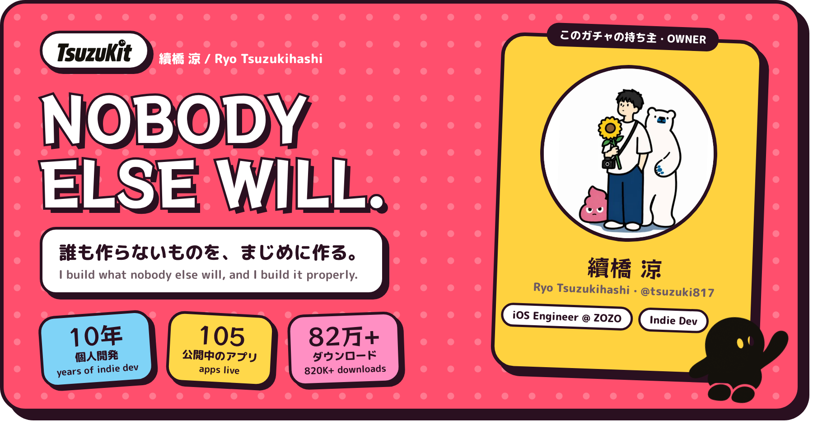</a>

續橋涼です。ふだんはZOZOでZOZOTOWNのiOSアプリを作っていて、それとは別に、大学生だった2016年から自分のアプリを出し続けています。いまApp Storeに105本あって、全部合わせると82万ダウンロードになりました。

作るのは、うんちの記録や目薬をさす時間の通知、貝殻を見分ける図鑑のように、誰かが市場がないと言って通り過ぎたものばかりです。そっち側を拾って、手を抜かずに作っています。

> I'm Ryo Tsuzukihashi. By day I build the ZOZOTOWN iOS app at ZOZO, and on the side I've kept shipping my own apps since 2016, back when I was at university. 105 of them are on the App Store today, with 820,000 downloads in total.
>
> Most of what I make is the stuff people walk past because there's "no market" for it: a poop log, an eye-drop reminder, a seashell field guide. I pick those up and build them properly.

  <a href="https://apps.apple.com/jp/app/id6758856276">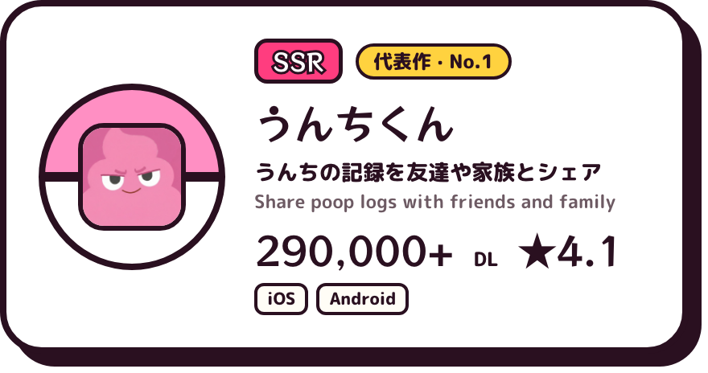</a>
  <a href="https://apps.apple.com/jp/app/id1598380826">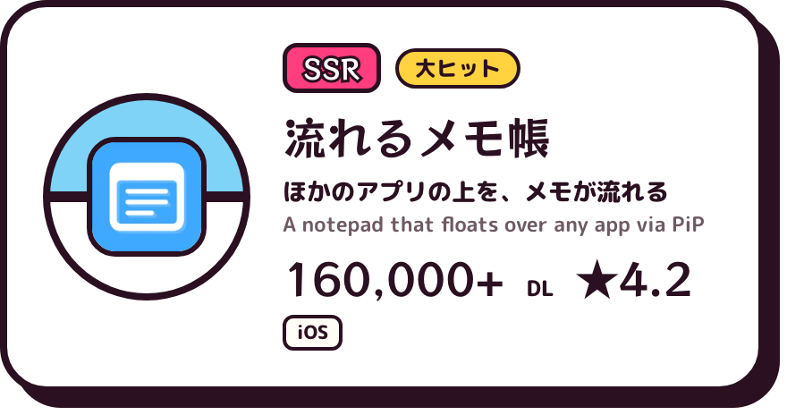</a>
  <a href="https://apps.apple.com/jp/app/id6478291625">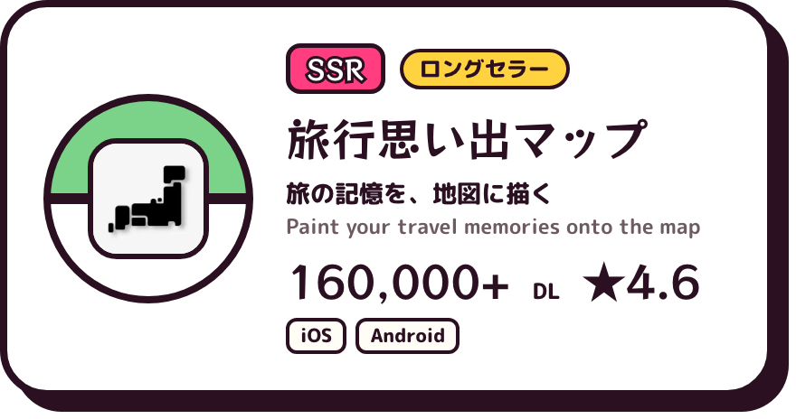</a>
  <a href="https://apps.apple.com/jp/app/id6751716346">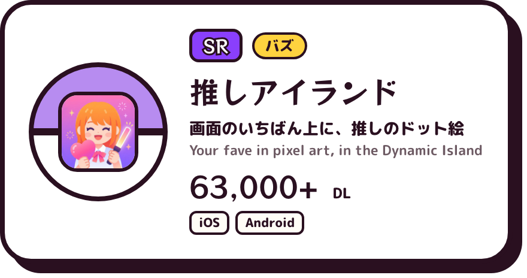</a>

<a href="https://tsuzukit.com/">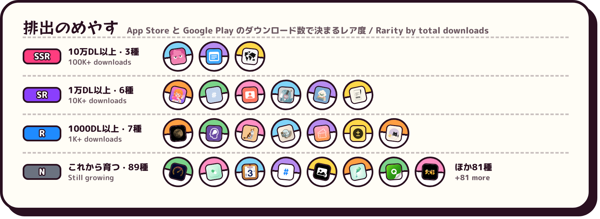</a>

tsuzukit.com はサイトそのものがガチャになっていて、回すと105本のうちどれかが1本出てきます。レア度はApp StoreとGoogle Playのダウンロード数を足して決めています。

> On tsuzukit.com the whole site is a capsule toy machine. Spin it and one of the 105 apps drops out. Rarity comes from App Store and Google Play downloads combined.

  <a href="https://tsuzukit.com/portfolio/">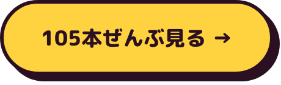</a>

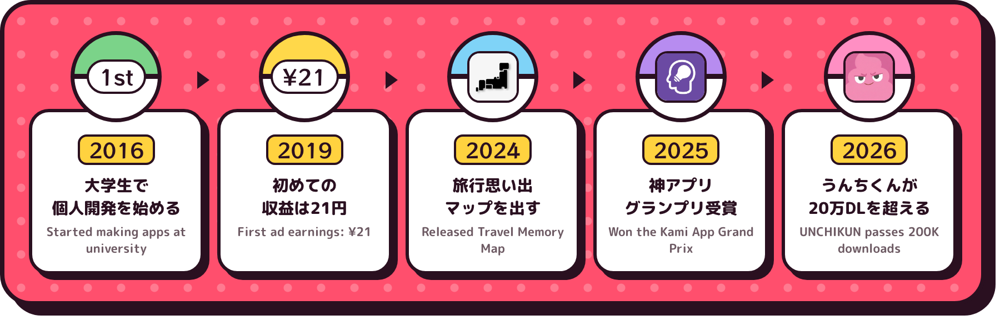

| | Company | What I work on |
|---|---|---|
| 2024 – | **ZOZO** | ZOZOTOWN の iOS アプリ The ZOZOTOWN iOS app |
| 2023 | **DeNA** | ライブ配信アプリ Pococha。ショート動画機能を技術検証から再生基盤まで担当 Pococha, a live streaming app. Owned the short video feature from validation to playback |
| 2019 | **Yahoo Japan** | PayPayフリマの立ち上げを LeanXP で。ペアプロと TDD が身についた Launched PayPay Flea Market with LeanXP, pair programming and TDD |
| 2016 – | **Indie** | App Store に 105 本 105 apps live on the App Store |

- [iOSDC Japan 2022](https://fortee.jp/iosdc-japan-2022/proposal/7646ca37-310b-42d1-8764-d80dd12714fd) で登壇しました。iOS 15 のピクチャ・イン・ピクチャで動画以外の UI を出す話です。 Spoke at iOSDC Japan 2022 about showing any UI, not just video, with Picture in Picture on iOS 15.
- いつでもタイマーが、YouTuber のマメさんが開いた神アプリグランプリでグランプリをもらいました。 AlwaysOnTimer won the grand prize at the Kami App Grand Prix.
- 流れるメモ帳は、マメさんに紹介されてから一気に伸びて16万ダウンロードを超えました。 Floating Notepad took off after being featured by Mame and passed 160,000 downloads.

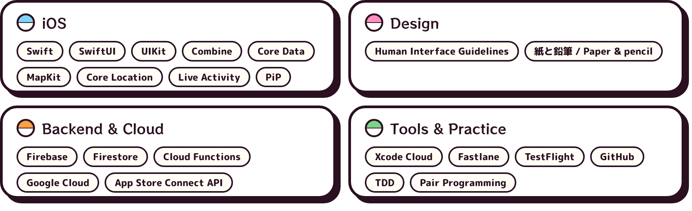

### 1. 言いにくいことほど、ちゃんと作る

うんちの記録も、推しへの気持ちも、真顔で設計します。照れた瞬間に作りが雑になるからです。人に言いにくい領域ほど、まだ誰も丁寧に作っていません。

> I design poop logs and feelings for your fave with a straight face. The moment you get embarrassed, the work gets sloppy, and the harder something is to talk about, the less likely anyone has built it with care.

### 2. 考えるより先に出す

出した月の数字では、当たりかどうか分かりません。8月は7本出して、売上は合わせて557円でした。前の月に1円も売れなかったアプリが、翌月に9万円を持ってきたこともあります。

> The month I ship an app tells me nothing about whether it's a hit. In August I shipped 7 apps and they made ¥557 together. An app that earned nothing one month brought in ¥90,000 the next.

### 3. 数字を隠さない

毎月の収益を全部ブログに出しています。伸びた月も、前提が崩れて計画を書き直した月も、同じ場所に並べています。

> I publish all of my revenue every month. The months that grew and the months I had to rewrite the plan sit side by side.

  <a href="https://tsuzukit.com/blog/income-report/">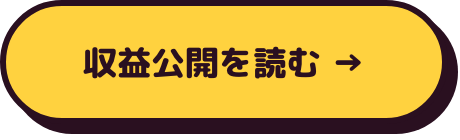</a>

  
  <a href="https://x.com/tsuzuki817">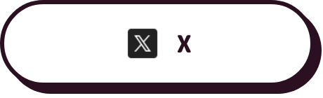</a>
  
  
  
  <a href="https://qiita.com/tsuzuki817">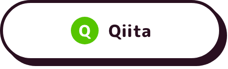</a>

